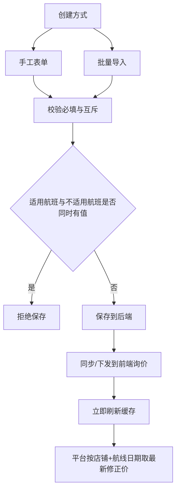
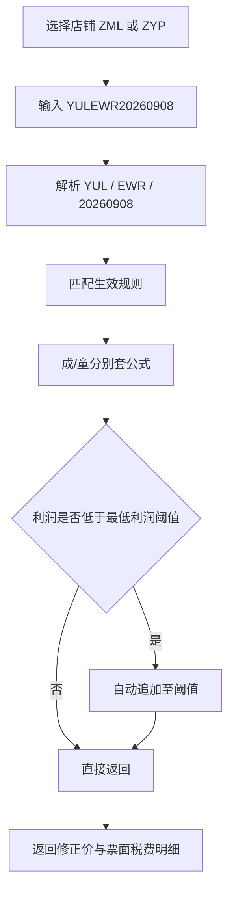
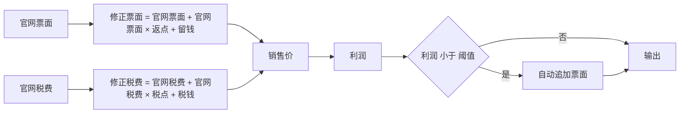
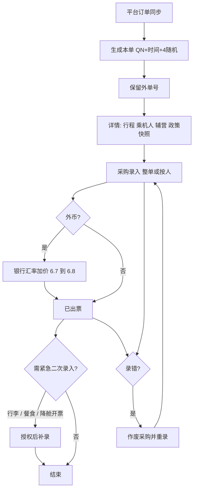

# 机票运价与订单管理系统 PRD

| 项 | 内容 |
| --- | --- |
| 产品名称 | 机票运价与订单管理系统 |
| 文档版本 | v1.1 |
| 文档状态 | 草稿 / 待评审 |
| 日期 | 2026-09-04 |
| 产品类型 | **全新独立产品**，与 AurisAI 无业务、数据、账号、技术绑定关系 |
| 适用范围 | 航空 OTA 后台：运价/加价规则配置与下发、平台询价、订单同步与采购履约 |
| 主要角色 | 运价员、出票员、值班经理、财务、系统管理员 |

---

## 1. 产品定位

### 1.1 一句话定位

后台配置运价/加价规则（手工或批量），即时下发并刷新缓存；平台按「店铺 + 航线日期」询价得到修正后的成人/儿童价；平台订单同步进本系统后，完成采购录入、紧急补录与作废重出。

### 1.2 要解决的问题

| 痛点 | 目标 |
| --- | --- |
| 加价规则靠表格，成/童口径不一致 | 成人、儿童各自维护返点/留钱/税点/税钱，公式唯一 |
| 改规则后面端仍卖旧价 | 规则变更后缓存立即刷新，询价读最新规则 |
| 利润被击穿或需要可控亏损 | 必填最低利润阈值（可为负）；不足时自动追加 |
| 出票后对不上当时规则 | 订单锁定政策快照 |
| 采购录错、辅营漏采 | 作废重出 + 紧急二次录入（行李/餐食/降舱开票） |
| 外币采购被汇率吃掉 | 取当日银行汇率后加价进位，例 `6.7 → 6.8` |

### 1.3 产品边界

**做：**

- 运价规则：手工创建、批量导入、编辑、停用；后端下发到前端/询价；变更即时刷缓存
- 按店铺 + 航线日期询价，返回修正票面、税费、成/童展示价
- 平台订单同步、本地单号、订单列表/详情、政策快照
- 采购录入、紧急二次录入、作废后重录

**不做（v1）：**

- C 端搜订、支付、会员
- 自动占位 / 自动出票机器人
- 与 AurisAI 的任何对接
- 税务申报、银行清结算（只记录采购支付信息供对账）

### 1.4 成功标准

1. 手工建规则与批量导入均可生效；改规则后询价立即用新规则。
2. 店铺 + `YULEWR20260908` 能返回该航线日期的修正价。
3. 公式：官网票面 800、返点 -1.5%、留钱 -5 → **783**；800、返点 5%、留钱 5 → **845**。
4. 展示口径可还原为：`GK100 成人1045 票面(1000-5) 税费(50+0)` / `儿童1050 票面(1000+0) 税费(50+0)`。
5. 同步订单生成本地单号 `QN` + `yyyyMMddHHmmss` + 4 位随机，并保留外部单号。
6. 采购可整单或按人录入；支持作废重录；紧急补录原因为行李 / 餐食 / 降舱开票。

---

## 2. 信息架构与角色

```
机票运价与订单管理系统
│
├── 工作台
│     ├── 待出票 / 临近最晚出票
│     ├── 待补录 / 待作废重录
│     └── 今日银行汇率（加价后）
│
├── 运价管理
│     ├── 规则列表
│     ├── 手工新建 / 编辑 / 复制 / 停用
│     ├── 批量导入
│     ├── 下发状态与缓存刷新
│     └── 询价试算（店铺 + 航线日期）
│
├── 订单管理
│     ├── 订单列表
│     ├── 订单详情（行程 / 乘机人 / 辅营 / 政策快照）
│     ├── 采购录入（整单或按人）
│     ├── 紧急二次录入
│     └── 作废重录
│
├── 基础数据
│     ├── 渠道（QN 去哪儿）
│     ├── 店铺（ZML / ZYP）
│     ├── 航司
│     └── 银行汇率
│
└── 系统
      ├── 角色权限（含紧急二次录入权限）
      └── 操作日志
```

### 2.1 权限矩阵

| 能力 | 运价员 | 出票员 | 值班经理 | 财务 | 管理员 |
| --- | --- | --- | --- | --- | --- |
| 规则查看 / 询价试算 | ✓ | ✓ | ✓ | ✓ | ✓ |
| 手工建规则 / 批量导入 / 停用 | ✓ | — | ✓ | — | ✓ |
| 订单查看 | ✓ 只读 | ✓ | ✓ | ✓ | ✓ |
| 采购录入 | — | ✓ | ✓ | — | ✓ |
| 紧急二次录入 | — | 需授权 | ✓ | — | ✓ |
| 作废采购并重录 | — | ✓ | ✓ | — | ✓ |
| 银行汇率维护 | — | — | ✓ | ✓ | ✓ |
| 角色与权限 | — | — | — | — | ✓ |

### 2.2 对象关系

```
渠道 QN（去哪儿）
  └── 店铺 ZML / ZYP
        └── 运价规则（政策代码 QNGK …）
              └── 下发到询价缓存 / 被订单快照引用

平台订单（外单）──同步──► 本地订单（本单）
  ├── 行程 / 仓位 / 成童价
  ├── 联系人
  ├── 乘机人（含起飞日年龄）
  ├── 辅营
  ├── 政策快照
  └── 采购记录（可作废后重录）
```

---

## 3. 运价 / 加价规则

规则在 **后端** 维护，保存后 **上传/同步到前端询价**，并 **立即刷新缓存**。创建方式两种，字段与校验完全一致：

1. **手工创建**：表单逐条录入。
2. **批量创建**：Excel/CSV 导入；失败行回传原因，成功行即时下发。

> **假设 A1**：批量模板列与 3.1 字段一一对应；同一文件内 `(店铺, 政策代码)` 不得重复。

### 3.1 字段总表

| 字段 | 示例 | 必填 | 空值含义 | 说明 |
| --- | --- | --- | --- | --- |
| 渠道 | `QN`（去哪儿） | **是** | — | v1 仅去哪儿。保存后不可改。 |
| 店铺 | `ZML` / `ZYP` | **是** | — | 经营单元，规则与询价按店铺隔离。保存后不可改。 |
| 政策代码 | `QNGK` | **是** | — | 店铺内唯一。 |
| 航司 | `GK` | **是** | — | IATA 二字码。一条规则一个航司。 |
| 仓位代码 | `Y,B,H` | 否 | **全部仓位** | 多仓位逗号分隔。空 = 该航司全部仓位。 |
| 出发 | 机场三字码 | 否 | **该航司全部出发机场** | 空或 `*` 均可表示全部。 |
| 抵达 | 机场三字码 | 否 | **该航司全部抵达机场** | 空或 `*` 均可表示全部。 |
| 适用航班 | `GK100` | 否 | 不限制 | 只卖列出的航班。与「不适用航班」**互斥**。 |
| 不适用航班 | `GK100` | 否 | 不限制 | 卖该航司其余航班，排除列出航班。与「适用航班」**互斥**。 |
| 政策类型 | 见 3.3 | **是** | — | 枚举不可扩展（除非改 PRD）。 |
| 行程类型 | 见 3.4 | **是** | — | 枚举不可扩展（除非改 PRD）。 |
| 最小售卖天数 | `1` | 否 | **不限制，含当天可售** | `1` = 不卖当天（起飞日当天禁售）。 |
| 最大售卖天数 | `60` | 否 | **不限制** | `60` = 第 61 天及更早的票禁售。 |
| 旅行日期 | `20260101–20261225` | 否 | **全部旅行日** | 起止；空 = 不限。 |
| 活动日期 | 起止 | 否 | 无活动窗 | 选填。 |
| 销售日期 | `20260901–20261225` | 条件见 3.5 | 见 3.5 | 开始可在活动前/中/后；**结束必须与活动同一天**。 |
| 最小票面 / 最大票面 | `1` / `1000` | 否 | 不限票面 | 仅当官网票面落在区间内才适用。例 `1–1000`。 |
| 最低利润阈值 | `-15` / `15` | **是** | — | **允许负数**。`-15` = 最多亏 15；`+15` = 至少赚 15。 |
| 成人返点 / 留钱 / 税点 / 税钱 | 可正可负 | 否 | 按 0 | 只作用于成人。 |
| 儿童返点 / 留钱 / 税点 / 税钱 | 可正可负 | 否 | 按 0 | 只作用于儿童。 |
| 状态 | 生效 / 停用 | **是** | — | 停用立即从缓存剔除。 |
| 政策更新时间 | 系统写入 | 是（系统） | — | 写入订单快照。 |

### 3.2 适用航班 vs 不适用航班

- 二者 **互斥**：不能同时有值。前端填一方则禁用并清空另一方；后端拒绝同时非空。
- `适用航班 = GK100`：仅 GK100。
- `不适用航班 = GK100`：该航司除 GK100 外均可（仍受出发/抵达/仓位等约束）。
- 均为空：不按航班号过滤。
- 航班号规范化：大写、去空格，`GK 100` → `GK100`。

### 3.3 政策类型（固定枚举）

**必须且仅使用以下值，不得替换为「指定航班 / 兜底保护」等其它分类：**

| 政策类型 |
| --- |
| 普通 |
| 积分 |
| 压位 |
| 促销 |
| 拉位 |
| 行李套餐 |
| 金牌产品 |

> **假设 A2**：同一店铺、同一航线日期命中多条时，返回全部命中规则，由平台按自身策略选用；本系统询价试算页按「更新时间新者优先」默认选中，允许手工改选。

### 3.4 行程类型（固定枚举）

**必须且仅使用以下值：**

| 行程类型 |
| --- |
| 单程 |
| 往返 |
| 中转 |

询价传入行程类型，只匹配勾选/等于该类型的规则。  
> **假设 A3**：一条规则的行程类型为单选（创建时选一个）。若业务需要一条规则同时覆盖单程+往返，再改为多选，不在 v1 默认范围。

### 3.5 售卖天数、旅行日期、活动日期、销售日期

**售卖天数**（相对起飞日的日历天数 `D = 起飞日 - 销售日`）：

| 字段 | 例 | 行为 |
| --- | --- | --- |
| 最小售卖天数空 | — | 当天也可卖（`D ≥ 0`） |
| 最小售卖天数 `1` | 不卖当天 | 须 `D ≥ 1` |
| 最大售卖天数空 | — | 多早都可卖 |
| 最大售卖天数 `60` | 禁售 61+ | 须 `D ≤ 60` |

**旅行日期**：选填。填写则起飞日须落入 `20260101–20261225` 这类闭区间；空 = 全部旅行日。

**活动日期**：选填。

**销售日期** 与活动日期的关系（用户原规则）：

1. 开始售卖 **可以在活动前、活动中、或活动后**（相对活动开始日）。
2. 销售 **必须与活动同一天结束**（销售结束日 = 活动结束日）。
3. 有活动日期时：销售结束日由系统锁定为活动结束日，不可单独改；改活动结束则同步销售结束。
4. 销售开始日 ≤ 销售结束日。

> **假设 A4**：未填活动日期时，不强制「与活动同一天结束」；销售日期可空（空 = 长期可售）或只填销售起止。一旦补填活动结束日，销售结束日必须对齐。  
> **假设 A5**：日期比较用后台时区 `Asia/Shanghai` 的日历日。

### 3.6 票面区间与最低利润阈值

- **最小票面 / 最大票面**：选填。例 `1–1000` 表示官网票面在该闭区间内才适用本规则。
- **最低利润阈值：必填，允许为负，禁止系统强制 ≥ 0。**
  - `-15`：最多允许亏损 15（利润 ≥ -15）。
  - `+15`：至少盈利 15（利润 ≥ 15）。
- 利润口径见第 4 节（成人、儿童分别算，再按人数合计）。

### 3.7 下发与缓存（硬性）

1. 手工保存、批量导入成功、编辑、停用，均触发 **同一套下发**。
2. 下发对象：前端询价缓存（以及平台询价所读的缓存层）。
3. **变更后缓存必须立即刷新**，不允许等定时任务。停用规则必须立刻不可被询价命中。
4. 下发失败要可重试，并在列表显示「未同步 / 已同步」。

> **假设 A6**：缓存键至少包含 `店铺 + 航司 + 出发 + 抵达 + 旅行日 + 行程类型`；航班号、仓位在命中后再过滤。具体分片由实现定，但正确性以「改完立刻查到新价」验收。

---

## 4. 价格公式与自动追加

### 4.1 公式

成人、儿童 **分别** 套用各自的返点/留钱/税点/税钱：

```
修正票面 = 官网票面 + (官网票面 × 返点) + 留钱
修正税费 = 官网税费 + (官网税费 × 税点) + 税钱
销售价   = 修正票面 + 修正税费
利润     = 销售价 - (官网票面 + 官网税费)
```

- 返点、税点按百分数录入：界面 `-1.5` 表示 `-1.5%`，计算用 `-0.015`。
- 留钱、税钱为金额，可正可负。
- 未填按 0。
- 金额最终 **保留 2 位小数**。

### 4.2 验收用例（必须进测试）

**修正票面 A（负返点 + 负留钱）：**

```
800 + (800 × -0.015) - 5
= 800 - 12 - 5
= 783
```

**修正票面 B（正返点 + 正留钱）：**

```
800 + (800 × 0.05) + 5
= 800 + 40 + 5
= 845
```

（第二例等价于公式中的 `+ 留钱`；用户示例写 `+ 5`。）

### 4.3 对客展示口径（询价返回）

平台需要同时看到 **卖价** 和 **票面/税费加减明细**。

示例（官网票面 1000、税费 50）：

| 旅客 | 票面加减 | 税费加减 | 展示 |
| --- | --- | --- | --- |
| 成人 | `1000-5`（留钱 -5） | `50+0` | **GK100 成人1045** 票面(1000-5) 税费(50+0) |
| 儿童 | `1000+0` | `50+0` | **儿童1050** 票面(1000+0) 税费(50+0) |

验算：成人修正票面 995 + 修正税费 50 = **1045**；儿童 1000 + 50 = **1050**。

询价接口至少返回：航班号、成人销售价、儿童销售价、成人票面原值/加减/修正、成人税费原值/加减/修正、儿童同样一组、政策代码。

### 4.4 自动追加阈值

计算完公式后，若 **利润 < 最低利润阈值**，系统 **自动加价**，直到利润达到阈值，再返回给平台。

> **假设 A7（细节未铺开，实现按本条）：**
>
> 1. 差额 `gap = 阈值 - 利润`。若 `gap ≤ 0` 不加。
> 2. 把 `gap` **全部加到修正票面**（不加到税），成人/儿童 **分别** 用各自利润与同一条规则的阈值比较并各自追加。
> 3. 追加后写入询价结果：`自动追加金额`、`追加前销售价`、`追加后销售价`。
> 4. 订单快照保存追加前后，避免对账对不上。
>
> 例：官网合计 1000，公式后销售 990，利润 -10，阈值 `+15` → gap = 25 → 销售改为 1015，利润 15。  
> 例：利润 -10，阈值 `-15` → 已满足，不追加。

---

## 5. 询价

### 5.1 入口

1. **店铺**（必选）：`ZML` 或 `ZYP`。
2. **航线 + 日期** 查询串（必填），例如：`YULEWR20260908`。

| 查询串 | 解析 |
| --- | --- |
| `YULEWR20260908` | 出发 **YUL** + 抵达 **EWR** + 日期 **2026-09-08** |

格式：`{出发三字码}{抵达三字码}{YYYYMMDD}`，长度 14，统一大写。

可选：航司、航班号、仓位、行程类型、官网成人票面/税、官网儿童票面/税、销售日（默认当天）。

### 5.2 匹配顺序

```
店铺 → 渠道 QN → 状态生效
→ 销售日期 / 旅行日期 / 售卖天数
→ 航司、仓位（空=全部）、出发抵达（空或*=该航司全部机场）
→ 适用航班 / 不适用航班
→ 行程类型
→ 官网票面落入最小/最大票面
→ 按成/童公式计算 → 阈值自动追加
→ 返回修正价（含展示明细）
```

无命中返回空列表。规则变更后本查询必须立即反映新缓存。

---

## 6. 订单管理

订单 **从平台同步**，不是本系统 C 端下单。同步成功后生成本地单号，并保留平台外部单号。

### 6.1 单号

| 类型 | 规则 | 示例 |
| --- | --- | --- |
| 本单（本地） | `QN` + `yyyyMMddHHmmss` + **4 位随机** | `QN20260902104722XXXF` |
| 外单（平台） | 平台原样保存 | `zml260902051659159fe0a1` |

- 本单生成后不改号。作废的是 **采购记录**，不是本地单号（见 7.3）。
- 4 位随机字符集：大写字母 + 数字；碰撞则重试。

### 6.2 列表字段

列表至少展示：

| 列 | 示例 / 说明 |
| --- | --- |
| 本单 | `QN20260902104722XXXF` |
| 外单 | `zml260902051659159fe0a1` |
| 状态 | **出票中**（以及同步后的其它状态：待出票、已出票、已作废采购等） |
| 来源 | **去哪儿** |
| 总价 | 订单销售合计 |
| 创建时间 | 平台/同步创建时间 |
| 支付时间 | 平台支付时间 |
| 最晚出票时间 | 超时风险排序用 |

### 6.3 详情 — 行程与价格

示例口径（必须能完整展示这类数据）：

| 项 | 示例 |
| --- | --- |
| 航司 | GK |
| 行程 | 单程 |
| 航班 | GK100 |
| 航线 | CGO–ICN |
| 仓位 | N |
| 成人价 | 995 |
| 儿童价 | 1000 |
| 联系人 | 有 |
| 电话 | 有 |
| 邮箱 | 有 |

成人价 995、儿童价 1000 可与询价票面一致（如票面 `1000-5` / `1000+0`）；税费在价格明细区分展示。

### 6.4 乘机人

每位乘机人：

| 字段 | 说明 |
| --- | --- |
| 姓名 | 证件姓名 |
| 类型 | 成人 / 儿童 / 婴儿 |
| 性别 | |
| 出生日期 | 同时展示 **航班起飞日年龄**（按第一段起飞日算周岁） |
| 护照号 | |
| 国籍 | |
| 签发地 | |
| 有效期 | |

主展示年龄必须是 **起飞日年龄**，不是下单日年龄。

### 6.5 辅营

| 字段 | 说明 |
| --- | --- |
| 名称 | 辅营产品名 |
| 添加方式 | **辅营打包** / **随单添加** |
| 规格 | **18 / 20 / 30 / 40 KG**（行李额等） |
| 数量 | |
| 合计 | 该辅营金额 |

### 6.6 政策快照

下单/同步时冻结当时规则，之后改规则不影响本单。快照至少包括：

| 项 | 示例 |
| --- | --- |
| 政策编码 | QNGK |
| 类型 | 普通 |
| 价格区间 | 最小票面–最大票面（空则记「不限」） |
| 最低利润 | 可为负 |
| 返点 / 留钱 / 税点 / 税钱 | **成人、儿童两套** |
| 政策更新时间 | 规则当时的更新时间 |
| 公式入参出参 | 官网价、修正票面、修正税费、是否自动追加及金额 |

---

## 7. 采购录入、紧急补录、作废

### 7.1 采购录入（票号表）

以 **乘机人 × PNR × 票号** 表格录入。支持：

- **整单一起录**：一次填齐全部乘机人；
- **按人逐条录**：先出谁录谁。

| 列 | 说明 |
| --- | --- |
| 乘机人姓名 | 带出，可核对 |
| PNR | |
| 票号 | |

同一订单允许部分人已有票号、部分人空着（未录完保持「出票中」）。

### 7.2 采购信息字段

每次提交采购（整单或按人）还需：

| 字段 | 说明 |
| --- | --- |
| 采购平台 | 实际采购来源 |
| 采购账号 | |
| 采购订单号 | |
| 采购币种 | |
| 支付方式 | **携程卡 / 个人卡 / 支付宝 / 微信 / 路涛 / 空中云汇** 等（可配置扩展） |
| 外币金额 | 外币采购时必填 |
| 卡号 | 卡类支付时 |
| 流水号 | |
| 亏损原因 | 利润为负或低于预期时填写 |
| 备注 | |

**汇率：** 取 **当日银行汇率**，再 **加价进位以免亏损**：`6.7 → 6.8`。人民币成本 = 外币金额 × 加价后汇率。原始汇率与加价后汇率都要落库。

> **假设 A8**：加价规则为在银行汇率上 **向上取到下一位 0.1**（6.7 记 6.8；6.71 同样进到 6.8）。若财务要求「固定 +0.1」（6.0 也变 6.1），只改这一处配置，字段不变。

### 7.3 作废并重录

提供 **作废** 按钮：作废 **错误的采购记录**（PNR/票号/支付信息），订单回到可重新录入状态，**本单号、外单号、行程与乘机人不变**。作废原因必填。作废后的旧采购只读留痕，然后按 7.1 / 7.2 重新录入。

### 7.4 紧急二次录入

独立权限。已出票后发现漏采，不走作废，做二次录入。

**原因枚举（固定）：**

- 行李
- 餐食
- 降舱开票

原因必填。写入辅营/采购补充记录与审计日志。无权限者看不到提交入口。

---

## 8. 流程图

### 8.1 规则创建、下发、刷缓存



### 8.2 询价



### 8.3 售价计算



### 8.4 订单同步与履约



---

## 9. 线框（ASCII）

> 高保真产品图（可点击切换页面）：[fare-order-product-maps.html](./fare-order-product-maps.html)

### 9.1 规则列表

```
+------------------------------------------------------------------------------+
| 机票运价与订单    工作台  运价管理*  订单管理  基础数据  系统                  |
+------------------------------------------------------------------------------+
| 店铺[ZML v] 渠道 QN  政策代码[QNGK]  航司[GK]  类型[全部 v]                  |
| 航线日期 [YULEWR20260908        ]  [查询]  [手工新建]  [批量导入]            |
+------------------------------------------------------------------------------+
| 代码   店铺 航司 类型 行程 仓位 出发 抵达 适用/不适用 阈值 同步   状态       |
| QNGK   ZML  GK   普通 单程 全部  *    *    —          -15  已同步 生效       |
| QNGK   ZYP  GK   促销 单程 Y,B  YUL  EWR  适用GK100   15   已同步 生效       |
+------------------------------------------------------------------------------+
```

### 9.2 手工新建规则

```
+------------------------------------------------------------------------------+
| 手工新建规则                         渠道 QN(去哪儿)*  店铺 [ZML|ZYP]*        |
| 政策代码 [QNGK]*   航司 [GK]*                                                 |
| 政策类型 [普通|积分|压位|促销|拉位|行李套餐|金牌产品]*                        |
| 行程类型 [单程|往返|中转]*                                                    |
| 仓位代码 [Y,B,H     ]  空=全部仓位                                            |
| 出发 [   ] 或 * = 该航司全部    抵达 [   ] 或 * = 该航司全部                   |
| 适用航班 [GK100     ]  ←互斥→  不适用航班 [          ]                        |
| 最小售卖天数 [1 ]空=都卖含当天   最大售卖天数 [60]空=不限  (60则61+禁售)     |
| 旅行日期 [20260101]~[20261225]  空=全部                                       |
| 活动日期 [        ]~[        ]  选填                                          |
| 销售日期 [20260901]~[        ]  开始可活动前/中/后；结束必须与活动同一天      |
| 最小票面 [1   ] 最大票面 [1000] 空=不限                                       |
| 最低利润阈值 [ -15 ]*   允许负数：-15=最多亏15；+15=至少赚15                  |
|           返点%      留钱       税点%      税钱                               |
| 成人     [-1.5 ]    [-5  ]     [ 0  ]     [ 0  ]                              |
| 儿童     [ 0   ]    [ 0  ]     [ 0  ]     [ 0  ]                              |
| 试算 官网票面800 → 修正票面 783                                               |
|                         [保存并立即下发缓存]  [取消]                          |
+------------------------------------------------------------------------------+
```

### 9.3 询价试算

```
+------------------------------------------------------------------------------+
| 店铺 [ZYP v]  航线+日期 [YULEWR20260908]  航班[GK100] 行程[单程] [询价]      |
+------------------------------------------------------------------------------+
| GK100  成人1045  票面(1000-5)  税费(50+0)                                     |
|        儿童1050  票面(1000+0)  税费(50+0)                                     |
| 政策 QNGK  普通  阈值 -15  自动追加 0                                         |
+------------------------------------------------------------------------------+
```

### 9.4 订单列表

```
+------------------------------------------------------------------------------+
| 本单                    外单                      状态   来源   总价         |
| QN20260902104722XXXF    zml260902051659159fe0a1   出票中 去哪儿  ...         |
| 创建时间          支付时间          最晚出票时间                              |
+------------------------------------------------------------------------------+
```

### 9.5 订单详情

```
+------------------------------------------------------------------------------+
| 本单 QN20260902104722XXXF    外单 zml260902051659159fe0a1    出票中  去哪儿  |
| [采购录入] [紧急二次录入] [作废]                                              |
+------------------------------------------------------------------------------+
| 航司 GK   行程 单程   航班 GK100   CGO-ICN   仓位 N                           |
| 成人价 995    儿童价 1000                                                     |
| 联系人 ______  电话 ______  邮箱 ______                                       |
|------------------------------------------------------------------------------|
| 乘机人  姓名  类型  性别  出生日期(起飞日年龄)  护照  国籍  签发地  有效期   |
|------------------------------------------------------------------------------|
| 辅营    名称  辅营打包|随单添加  18/20/30/40KG  数量  合计                    |
|------------------------------------------------------------------------------|
| 政策快照  编码QNGK  类型普通  价格区间  最低利润                              |
|           返点/留钱/税点/税钱 成人 | 儿童     政策更新时间                    |
+------------------------------------------------------------------------------+
```

### 9.6 采购录入 / 紧急补录 / 作废

```
+--------- 采购录入（整单 | 按人）----------+  +--- 紧急二次录入（需权限）---+
| 乘机人     PNR        票号                 |  | 原因:                      |
| ZHANG/SAN  ABC123     205XXXXXXXXXX        |  | ( )行李 ( )餐食 ( )降舱开票|
| LI/SI      ABC123     205YYYYYYYYYY        |  | 说明 [                  ]  |
|                                            |  |            [提交]          |
| 采购平台 [    ]  采购账号 [    ]           |  +----------------------------+
| 采购订单号 [    ]  币种 [    ]             |
| 支付方式 [携程卡|个人卡|支付宝|微信|       |
|           路涛|空中云汇|…]                 |  +--- 作废 -------------------+
| 外币金额 [    ]  卡号 [    ]  流水号 [  ]  |  | 作废错误采购并允许重新录入 |
| 银行汇率 6.7 → 加价 6.8（只读）            |  | 原因 [                  ]  |
| 亏损原因 [    ]  备注 [    ]               |  |            [确认作废]      |
|              [提交]                        |  +----------------------------+
+--------------------------------------------+
```

---

## 10. 非功能

| 项 | 要求 |
| --- | --- |
| 缓存 | 规则保存/导入/停用后询价立即命中新数据，禁止仅靠定时刷新 |
| 性能 | 单次询价 P95 < 1s（单店铺生效规则量级 2 万内） |
| 并发 | 同一订单采购提交乐观锁，禁止票号互相覆盖 |
| 隔离 | 数据按店铺隔离；跨店须授权 |
| 审计 | 规则变更、下发、采购、作废、紧急补录、汇率修改全量留痕 |
| 时区 | Asia/Shanghai |
| 保留 | 订单与快照 ≥ 24 个月 |

---

## 11. 假设汇总（未在需求原文展开的实现约定）

| ID | 假设 | 若推翻则改 |
| --- | --- | --- |
| A1 | 批量模板列 = 手工字段 | 模板另发 |
| A2 | 多规则命中时全部返回，试算默认最新 | 改优先级表 |
| A3 | 行程类型单选 | 改多选 |
| A4 | 无活动日期时不强制销售结束对齐 | 销售也必填并对齐「无活动」 |
| A5 | 日期用上海日历日 | 改航司当地日 |
| A6 | 缓存键由实现分片，验收看即时性 | 指定 Redis 结构 |
| A7 | 利润不足把差额加到修正票面，成/童分别追加 | 按人合计后再拆分 |
| A8 | 汇率向上进到 0.1（6.7→6.8） | 改为固定 +0.1 |
| A9 | 婴儿价 v1 可先复用儿童公式或原样出官网价，订单仍展示婴儿乘机人 | 婴儿独立返点 |
| A10 | 「前端」指询价/展示所用缓存与接口，不是 C 端 App | 明确再拆端 |

---

## 12. 开放问题

| # | 问题 | 建议默认 | 谁拍板 |
| --- | --- | --- | --- |
| 1 | 6.7→6.8 是「进到下一个 0.1」还是「一律 +0.1」？ | A8：进到下一个 0.1 | 财务 |
| 2 | 自动追加加在票面还是票面+税分摊？ | A7：只加票面 | 运价 |
| 3 | 往返/中转是否去回各匹配一条规则？ | 去程主查询串；回程另传航线日期 | 运价 |
| 4 | 城市码 NYC 是否展开 JFK/EWR/LGA？ | 否，必须机场三字码 | 运价 |
| 5 | 政策代码全局唯一还是店铺内唯一？ | 店铺内唯一 | 运价 |
| 6 | 作废是否通知去哪儿平台？ | v1 只作废本地采购 | 出票 |
| 7 | 紧急二次录入是否必须关联 EMD？ | 选填 | 出票 |
| 8 | 批量导入是覆盖同代码还是拒绝重复？ | 拒绝，需先停用 | 运价 |

---

## 13. 实现顺序

| 阶段 | 内容 | 验收要点 |
| --- | --- | --- |
| P0 | 规则数据模型 + 手工 CRUD + 公式（成/童）+ 阈值自动追加 | 783 / 845；阈值可为负；航班互斥 |
| P0 | 保存后下发并 **立即刷缓存** | 改留钱后再询价立刻变 |
| P0 | 询价：店铺 + `YULEWR20260908`，返回展示明细 | GK100 成人1045 / 儿童1050 口径 |
| P1 | 批量导入 | 与手工同一校验 |
| P1 | 订单同步、本单号、列表（本单/外单/出票中/去哪儿/总价/创建/支付/最晚出票） | 示例单号可复现格式 |
| P1 | 详情：行程、联系人、乘机人（起飞日年龄）、辅营、政策快照 | 快照含成/童加减价 |
| P2 | 采购录入（整单/按人）+ 支付方式 + 银行汇率 6.7→6.8 | 字段齐全 |
| P2 | 作废重录；紧急二次录入权限（行李/餐食/降舱开票） | 无权限无入口 |

不依赖 AurisAI，本系统独立库、独立账号、独立部署。

---

## 14. 验收清单

- [ ] 手工创建、批量创建都能保存并下发；改规则后缓存立即更新。
- [ ] 必填：渠道 QN、店铺 ZML/ZYP、政策代码 QNGK、航司 GK、政策类型、行程类型、最低利润阈值。
- [ ] 政策类型仅为：普通 / 积分 / 压位 / 促销 / 拉位 / 行李套餐 / 金牌产品。
- [ ] 行程类型仅为：单程 / 往返 / 中转。
- [ ] 仓位空 = 全部；出发/抵达空或 `*` = 该航司全部机场。
- [ ] 适用航班与不适用航班不能同时保存。
- [ ] 最小售卖天数 `1` 不卖当天；空则含当天。最大 `60` 则 61+ 禁售；空则不限。
- [ ] 旅行日期、活动日期、票面区间均可空。
- [ ] 销售开始可在活动前/中/后；销售结束与活动同一天（有活动时）。
- [ ] 最低利润阈值可填 `-15`，系统不得改成必须 ≥ 0。
- [ ] 成/童各自返点、留钱、税点、税钱，可正可负。
- [ ] `800 + (800×-0.015) - 5 = 783`；`800 + (800×0.05) + 5 = 845`。
- [ ] 利润低于阈值时自动追加。
- [ ] 询价示例可展示：成人1045 票面(1000-5) 税费(50+0)；儿童1050 票面(1000+0) 税费(50+0)。
- [ ] 本单 `QN20260902104722XXXF` 形态；外单原样保存。
- [ ] 列表含本单、外单、状态出票中、来源去哪儿、总价、创建/支付/最晚出票时间。
- [ ] 详情含 GK / 单程 / GK100 / CGO-ICN / 仓位 N / 成人价儿童价 / 联系人电话邮箱。
- [ ] 乘机人含起飞日年龄、护照、国籍、签发地、有效期。
- [ ] 辅营含打包/随单添加与 18/20/30/40KG。
- [ ] 快照含 QNGK、普通、价格区间、最低利润、成/童四项加减价、政策更新时间。
- [ ] 采购可整单或按人；字段含采购平台/账号/订单号/币种/支付方式/外币/卡号/流水号/亏损原因/备注。
- [ ] 汇率 6.7→6.8。
- [ ] 紧急二次录入需权限，原因为行李 / 餐食 / 降舱开票。
- [ ] 作废错误采购后可重录。

---

## 15. 修订记录

| 版本 | 日期 | 说明 |
| --- | --- | --- |
| v1.0 | 2026-09-04 | 初稿（已废弃其中与需求冲突的枚举与命名） |
| v1.1 | 2026-09-04 | 按原始需求校正：政策类型/行程类型、阈值可为负、成童分列、批量与即时缓存、订单与采购字段、自动追加 |

---

*独立产品文档，不依赖、不引用、不对接 AurisAI。*
